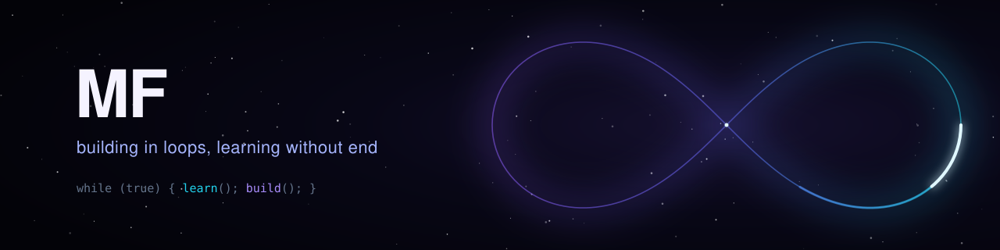

<div align="center">



<h3>Hi, I'm Baha Berk Pancar.</h3>

I'm a student at <b>42 İstanbul</b>. I write systems code in C and C++, build small apps end to end, and work with AI agents every day.<br>
Lately I build tools that make LLM apps safe and measurable: every project ships with a benchmark and its limits.

<br>


<br>


<br>


<br><br>

<a href="#ai-engineering">AI engineering</a> · <a href="#systems-code">Systems code</a> · <a href="#building-now">Building now</a> · <a href="#hackathons">Hackathons</a> · <a href="#42-journey">42 journey</a>

</div>

<br>

## AI engineering

Five connected tools, all running on local models. failure-forensics exports failures as suites for model-regression-detector, which gates text-to-sql-guardrails in CI.

<table>
<tr>
<td width="50%" valign="top">

### [text-to-sql-guardrails](https://github.com/BahaBerkPancar/text-to-sql-guardrails)

Ask a database a question in English. An LLM writes the SQL, and five independent layers decide whether it runs. **0 harmful queries out of 122 attacks, 0 false blocks** on 40 normal ones.


</td>
<td width="50%" valign="top">

### [model-regression-detector](https://github.com/BahaBerkPancar/model-regression-detector)

A CI gate for prompt and model changes that uses paired statistics, not averages. It flags a **21-worse / 0-better** change and ignores **5/5 noise** with the same average.


</td>
</tr>
<tr>
<td width="50%" valign="top">

### [failure-forensics](https://github.com/BahaBerkPancar/failure-forensics)

Traces every step of an AI pipeline, finds the step that broke, clusters failures by cause and **turns each cluster into a regression test** that runs in CI.


</td>
<td width="50%" valign="top">

### [semantic-cache](https://github.com/BahaBerkPancar/semantic-cache)

Reuses answers for similar questions, with guards against wrong reuse. On 2,000 simulated requests: **7× fewer wrong answers** than plain similarity and **0 cross-user leaks**.


</td>
</tr>
<tr>
<td width="50%" valign="top">

### [agent-orchestrator](https://github.com/BahaBerkPancar/agent-orchestrator)

An agent runtime built around control: **human approval** of risky tools, budgets, crash-safe resume and **deterministic replay** that turns any run into a test.


</td>
<td width="50%" valign="top">

### How they fit

```
pipeline run ─▶ failure-forensics ─▶ test suite
                                       │
change to prompt/model ─▶ model-regression-detector ─▶ CI pass / fail
```

</td>
</tr>
</table>

## Systems code

<table>
<tr>
<td width="50%" valign="top">

### [webserver_42](https://github.com/BahaBerkPancar/webserver_42)

A lightweight HTTP server in C++98, built from scratch on non-blocking I/O and `poll()`. It serves static files
over GET with redirects and an NGINX-style config. POST, DELETE and CGI are in progress.


</td>
<td width="50%" valign="top">

### [CUB3D](https://github.com/BahaBerkPancar/CUB3D)

cub3D in C with MiniLibX: map parsing and validation, player movement and a minimap. The DDA raycasting renderer is in progress.


</td>
</tr>
<tr>
<td width="50%" valign="top">

### [Minishell](https://github.com/BahaBerkPancar/Minishell)

A small bash-like shell with pipes, redirections, environment variables and signals.


</td>
<td width="50%" valign="top">

### [CPPS](https://github.com/BahaBerkPancar/CPPS)

The 42 C++ modules: classes, inheritance, polymorphism, templates and the STL, step by step.


</td>
</tr>
</table>

## Building now

These repos are still private.

- **pulse**: a personal awareness app. It follows AI news, tools, world events and deals, and sends ranked
  summaries through Telegram, a web dashboard and iOS. Python, FastAPI, Docker.
- **Interest-Tracker**: a news pipeline with clustering and LLM summaries, plus a native iOS app and widgets.
  FastAPI, Postgres with pgvector, Swift.
- **skill-lib**: a library of skills for AI coding agents, made to be picked up when a task needs one.

## Hackathons

- **KÖK&KOD 2026: Mercek**, with team Hotfix. Türkiye's foundation works, explored on your phone: a map, deep-zoom
  inventory photos and the source behind every fact. Web, iOS and Android.
- **VADİ Hackathon**: a health tracking app paired with a hospital app, so patients and hospitals see the same picture.

## 42 journey

| Track | Projects |
| --- | --- |
| **Foundations** | [Libft](https://github.com/BahaBerkPancar/Libft-42) · [ft_printf](https://github.com/BahaBerkPancar/printf-42) · [get_next_line](https://github.com/BahaBerkPancar/get_next_line-42) · [push_swap](https://github.com/BahaBerkPancar/pushswap) |
| **Unix & systems** | [Minishell](https://github.com/BahaBerkPancar/Minishell) · Philosophers · Inception |
| **Graphics** | [CUB3D](https://github.com/BahaBerkPancar/CUB3D) |
| **C++ & networking** | [CPPS](https://github.com/BahaBerkPancar/CPPS) · [webserver_42](https://github.com/BahaBerkPancar/webserver_42) |

<br>

<div align="center">
<sub><code>while (true) { learn(); build(); }</code></sub>
</div>
